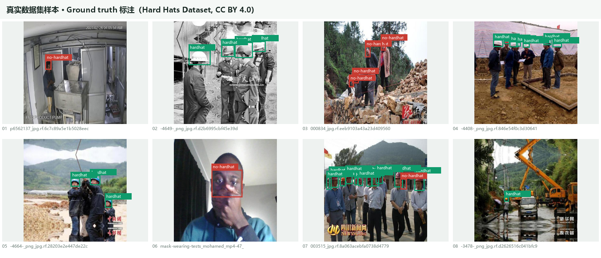
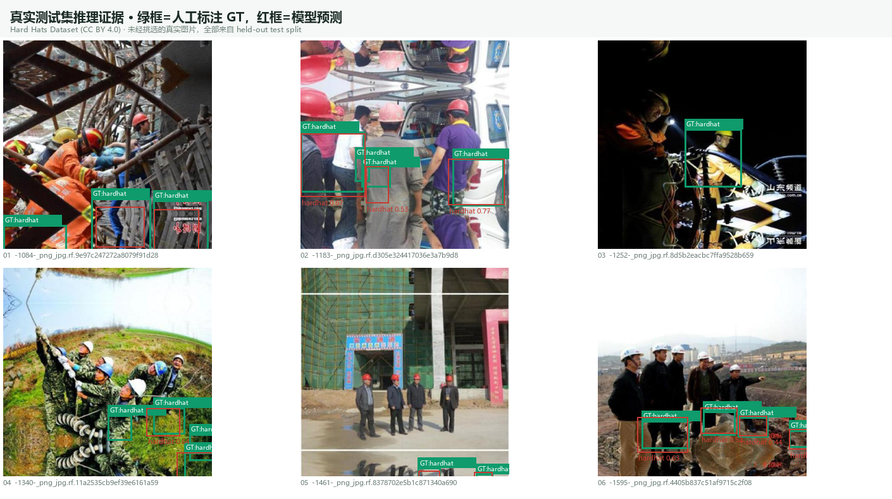

# 工地现场安全帽识别与预警系统

> 基于 YOLOv8 的真实数据训练、独立测试集评估、单变量公平 A/B 与可复核证据链。
> **v2 全部数字来自实际运行；项目里没有演示检测器，没有编造的精度。**

[](https://github.com/ljh-ningxia/helmet-safety-yolo/actions/workflows/ci.yml)


---

## 一、解决什么问题

工地安全帽依赖人工巡查，存在三个具体失效点：

1. **漏检** —— 远景小目标在监控画面里只有十几个像素，人眼和整图推理都容易漏；
2. **告警风暴** —— 单帧误检让告警忽明忽暗，现场人员很快对警报脱敏；
3. **没有闭环** —— 常见做法止步于「画个框」，缺少分级、去重、留痕与可追溯证据。

本项目交付的不只是一个 `detect()`，而是一条**从真实数据到可复核结论**的完整链路：

```
公开真实数据集 → 校验/分层/转换 → 真实训练 → 独立测试集评估
      → 单变量 A/B（收益与代价同时测） → 推理服务 + 分级告警 → 自动生成的证据文档
```

<!-- AUTO:RESULTS START -->
### 实测结果（自动生成，勿手改）

| 指标 | 实测值 |
|---|---|
| 训练数据 | 3200 张真实图（train/valid/test 分层子集） |
| 训练 epoch | — · CPU `— s` |
| mAP@0.5 | **—** |
| mAP@0.5:0.95 | **—** |
| Precision / Recall | — / — |
| 独立测试图片 | — |
| CPU 推理 P95 | — ms |
| CPU 吞吐 | — FPS |

来源：`experiments/results/{train_run,evaluation,benchmark,dataset_audit}.json`。
运行 `python scripts/07_generate_docs.py` 可重新生成。
<!-- AUTO:RESULTS END -->

---

## 二、快速开始

```bash
# 0. 环境
python -m pip install -r requirements-dev.txt

# 1. 取权重 + 真实数据集（约 1.1 GB，断点续传 + SHA256 校验）
python scripts/00_fetch_weights.py
python scripts/01_download_dataset.py

# 2. 数据工程：COCO 校验 → 分层抽样 → YOLO 转换 → EDA 审计
python scripts/02_prepare_dataset.py

# 3. 真实训练（CPU 约 30–40 分钟；GPU 可把 subset 设为 null 跑全量）
python scripts/03_train.py

# 4. 独立测试集评估 + 延迟基准 + 场景切片 + 真实推理证据图
python scripts/04_evaluate.py

# 5. 单变量公平 A/B
python scripts/05_run_ab.py --limit 60

# 6. 由实测 JSON 重新生成 README / 数据卡 / 模型卡 / 评估报告
python scripts/07_generate_docs.py

# 7. 服务与看板
python -m helmet_safety.cli serve --port 8000
```

打开 `http://127.0.0.1:8000` 看实时看板；`python -m helmet_safety.cli doctor` 可一键体检缺哪些产物。

---

## 三、真实数据，不是合成图

| 项 | 说明 |
|---|---|
| 数据集 | **Hard Hats Dataset**（Roboflow Universe, 2022），Hugging Face 镜像 `keremberke/hard-hat-detection` |
| 规模 | 19,745 张真实工地图像：train 13,782 / valid 3,962 / test 2,001 |
| 类别 | `hardhat`（已佩戴）/ `no-hardhat`（未佩戴，即告警对象） |
| 标注 | COCO JSON，人工标注；本项目做 COCO→YOLO 转换 |
| 许可 | **CC BY 4.0**，署名见 [`NOTICE.md`](NOTICE.md) 与 [`docs/DATASET.md`](docs/DATASET.md) |
| 上游预处理 | EXIF 定向 + 拉伸到 640×640，未做增强（**已知域偏移，写在数据卡里**） |

数据工程不是「解压即用」：

- **校验**：重复 image/annotation id、孤儿标注、越界框、零面积框全部计数并写入报告；
- **分层抽样**：按「框数分箱 × 是否含违规」分桶做最大余数法抽样，固定 seed，防止把稀有的 `no-hardhat` 抽没；
- **EDA**：类别不平衡、COCO 尺度桶、框面积分位、亮度分位、MD5 完全重复图，全部从真实像素算出来；
- **可复核**：每个压缩包有 SHA256，上游 revision 固定，统计落在 `experiments/results/dataset_audit.json`。



---

## 四、系统设计与三项可独立开关的改进

| 模块 | 解决什么 | 代价 | 如何验证 |
|---|---|---|---|
| **切片推理** `tiling.py` | 远景小目标被 640px 输入压缩 | 多次前向 → 延迟上升、重叠区误检 | E1：同一批真实图，只开 `enable_tiling` |
| **时序投票** `temporal.py` | 单帧误检导致告警闪烁 | 引入 3–5 帧确认延迟 | E3：只开 `enable_temporal` |
| **分级告警闭环** `alert/policy.py` | 只画框无业务动作 | 冷却期内可能压掉真实事件 | E4：只开 `enable_alert_dedup` |

另有 `E2` 做置信度阈值校准。四组实验**每次只改一个变量**，A/B 共享同一权重、同一批图片、同一顺序与 seed，并**同时报告收益和代价**（召回、误检、延迟、事件数）。



> 绿框 = 人工标注真值，红框 = 模型预测。全部来自独立 test split。

---

## 五、证据链

任何一个数字都能顺着这条链查到原始日志：

```
configs/train/default.yaml
        ↓  scripts/03_train.py
experiments/runs/yolov8n-hardhat/results.csv   ← 逐 epoch 真实曲线
        ↓  model.val(split="test")
experiments/results/evaluation.json            ← 官方 P/R/mAP
experiments/results/benchmark.json             ← 逐次推理的原始延迟样本
experiments/results/ab_*.json                  ← 冻结条件 + A/B 原始计数
        ↓  scripts/07_generate_docs.py
README / docs/MODEL_CARD.md / docs/EVALUATION.md
```

`train_run.json` 里记录了完整命令、git commit、Python/torch/ultralytics 版本、CPU 核数与设备。文档里的数字由脚本从这些 JSON 渲染，**不手工誊写**，因此不会出现「PPT 和 JSON 对不上」。

---

## 六、工程规范

- 配置集中、类型化、带校验（`configs/*/default.yaml` + env overlay）
- 结构化日志：`HELMET_LOG_JSON=1` 输出可索引 JSON 行
- 强类型 schema（`BBox` / `Detection` / `FrameResult` / `AlertEvent`）
- FastAPI 服务 + Web 看板；**权重缺失时 `/detect` 明确返回 503，绝不用假结果兜底**
- 30+ 单测（CI 不需要权重文件）、GitHub Actions、Dockerfile、Makefile、pyproject
- ADR 记录关键取舍，模型卡 / 数据卡 / 复现指南齐备

```bash
pytest -v                       # 单元测试
ruff check src scripts tests    # 静态检查
python -m helmet_safety.cli doctor
```

---

## 七、结论边界（请和结果一起读）

完整版见 [`docs/BOUNDARIES.md`](docs/BOUNDARIES.md)。最要紧的三条：

1. 指标只在**这一个公开数据集**上测过，不代表客户自有摄像头的表现；上游做过拉伸缩放，存在域偏移。
2. 数据集是**离散图片而非连续监控视频**，时序模块无法据此证明真实视频稳定性，A/B 报告里明确标注了这一点。
3. 时延是 **CPU 单图同步推理**，没有 TensorRT / ONNX 优化，不能当边缘部署结论；类别不平衡使少数类召回天然偏低，上线前必须用现场数据重新校准阈值。

---

## 八、文档索引

| 文档 | 内容 |
|---|---|
| [`docs/ARCHITECTURE.md`](docs/ARCHITECTURE.md) | 分层架构、数据契约、推理链路 |
| [`docs/DATASET.md`](docs/DATASET.md) | 数据卡：来源、许可、实测画像、偏差 |
| [`docs/MODEL_CARD.md`](docs/MODEL_CARD.md) | 模型卡：训练配置、实测指标、适用/不适用场景 |
| [`docs/EVALUATION.md`](docs/EVALUATION.md) | 官方验证、延迟基准、场景切片、A/B、失败案例 |
| [`docs/BOUNDARIES.md`](docs/BOUNDARIES.md) | 诚实的结论边界与未测项 |
| [`docs/REPRODUCE.md`](docs/REPRODUCE.md) | 从零复现的逐步命令与预期产物 |
| [`docs/ADR/`](docs/ADR/) | 架构决策记录 |
| [`CHANGELOG.md`](CHANGELOG.md) | v1 → v2 变更 |

---

## 九、许可与合规

- 本仓库**原创代码** MIT，见 [`LICENSE`](LICENSE)。
- **训练数据 CC BY 4.0**，需署名，见 [`NOTICE.md`](NOTICE.md)。
- **YOLOv8n 基座权重 AGPL-3.0**；商用部署需评估 Ultralytics Enterprise 授权或更换骨干，见 `NOTICE.md`。
- 原始图片、解压结果与权重**不进入 git**（`.gitignore`），仓库只保留下载脚本、校验和与统计。
- 涉及人员影像，生产部署须遵守隐私与工作场所监控相关法规。

---

<div align="center"><sub>让每一次改进，都留下可复核的证据。</sub></div>
